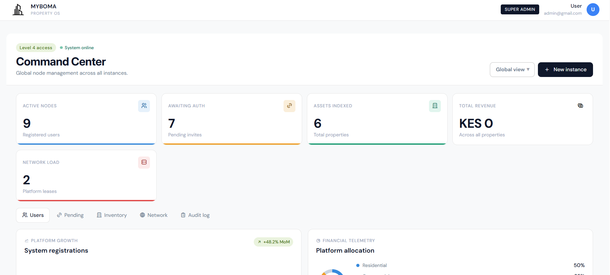
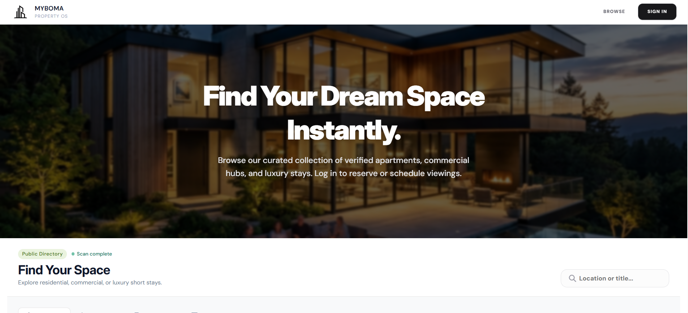
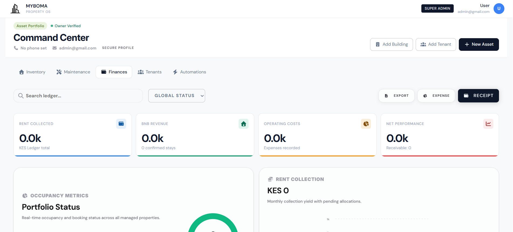

# MyBoma - Property OS

## PWA

The app is configured as an installable Progressive Web App with a generated manifest, service worker, and app icons.

```bash
npm install
npm run build
npm run preview -- --host 0.0.0.0 --port 4173
```

Open `http://localhost:4173/` to test the built PWA locally. Phone installs require HTTPS in production; `localhost` is accepted for local desktop testing.

## Android and iPhone Apps

This project uses Capacitor to package the same Vite app for Android and iOS.

```bash
npm run mobile:sync
```

Android:

```bash
npm run mobile:open:android
npm run mobile:android
```

The Android debug APK builds to `android/app/build/outputs/apk/debug/app-debug.apk`.

iPhone:

```bash
npm run mobile:open:ios
npm run mobile:ios
```

iOS builds must be run on macOS with Xcode. The generated iOS project is in `ios/App`.

Set `VITE_API_BASE_URL` to your deployed HTTPS gateway URL before building Android/iOS so BFF calls can reach `/api/mobile` from a phone.

## API Gateway and BFF

The Express gateway exposes separate BFF prefixes for web and mobile:

```bash
npm run server
```

- Web BFF: `/api/web`
- Mobile BFF: `/api/mobile`
- Legal documents: `/api/legal`
- Waitlist signup: `POST /api/waitlist`
- Waitlist unsubscribe: `POST /api/waitlist/unsubscribe`
- Stripe webhook: `/api/webhooks/stripe`
- Pesapal callback: `/api/payments/pesapal/callback`
- Pesapal IPN listener: `/api/webhooks/pesapal/ipn`
- M-Pesa STK callback: `/api/webhooks/mpesa/stk`
- Daily jobs (Vercel Cron): `GET /api/cron/daily` — expires lapsed plans, generates rent invoices, sends reminders

All public API routes and webhooks are rate limited. BFF routes require a Better-Auth session (cookie on web, bearer token on mobile), validate request bodies with Zod, sanitize string input, and keep provider secrets on the server.

Before enabling payments in production:

1. Copy `.env.example` to `.env` and fill the server-only keys.
2. Apply the schema to Neon with `npm run db:push` (Drizzle schema in `db/schema/`). On an existing database run `docs/migrations/05-indexes-and-invoice-dedupe.sql` first so duplicate invoices don't block the new unique index. `supabase-setup.sql` is historical only.
3. Configure Stripe webhook events for `checkout.session.completed` and `checkout.session.async_payment_succeeded`.
4. Configure Pesapal API 3.0:
   - Website URL: `https://myboma.vercel.app`
   - Callback URL: `https://myboma.vercel.app/api/payments/pesapal/callback`
   - IPN listener URL: `https://myboma.vercel.app/api/webhooks/pesapal/ipn`
   - Register the IPN listener in Pesapal and set the returned IPN ID as `PESAPAL_NOTIFICATION_ID`.
5. Set `MPESA_CALLBACK_URL` to `https://your-domain/api/webhooks/mpesa/stk` and set `MPESA_CALLBACK_SECRET` (required in every environment). The server appends `?secret=` to the URL it sends Safaricom; callbacks without it are rejected, and the paid amount is checked against the invoice.
6. Set `SUPER_ADMIN_EMAILS` (comma-separated). An address is promoted only after its owner verifies it (email link or Google sign-in).
7. Set `CRON_SECRET` in Vercel so the daily cron in `vercel.json` can call `/api/cron/daily`.
8. Configure SMTP. It is required for email verification (which gates super-admin bootstrap and admin invitations for email/password sign-ups), as well as notifications and waitlist emails.
9. Add each landlord payout configuration:
   - Stripe: `users.stripeAccountId` must be a Stripe Connect account ID.
   - M-Pesa: `users.mpesaSettlementPhone` is used for optional B2C settlement after successful STK confirmation.

M-Pesa STK Push collects to the configured business shortcode. To move funds onward to landlords automatically, enable and configure the B2C settlement env vars.

## Legal and Monitoring

Signup requires acceptance of the current Terms and Conditions and Privacy Policy versions before account creation. Copies live in:

- `docs/terms-of-use.md`
- `docs/privacy-policy.md`

Sentry is optional and enabled by setting `VITE_SENTRY_DSN` for the app and `SENTRY_DSN` for the gateway. The config disables default PII collection.

Admin Dashboard:


Landing page:


Landlord:

